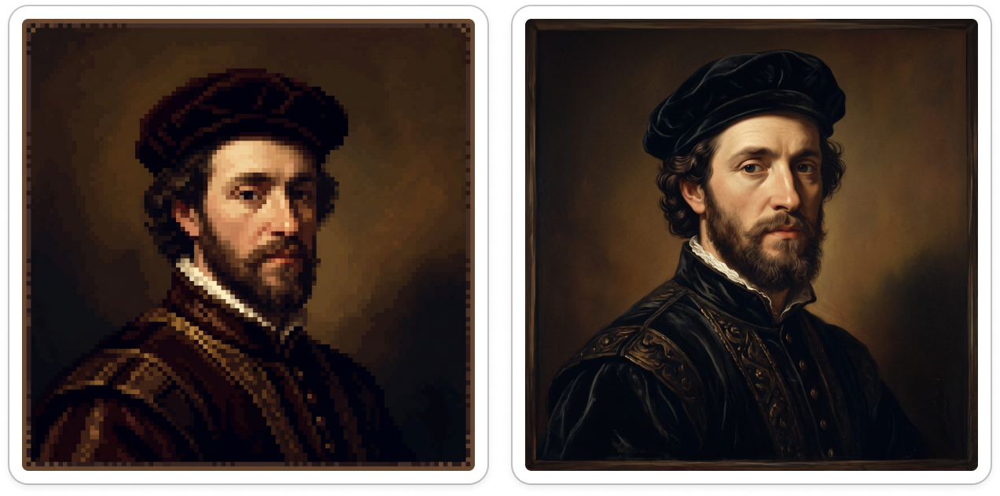
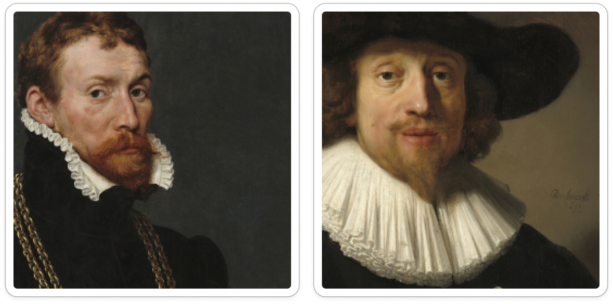
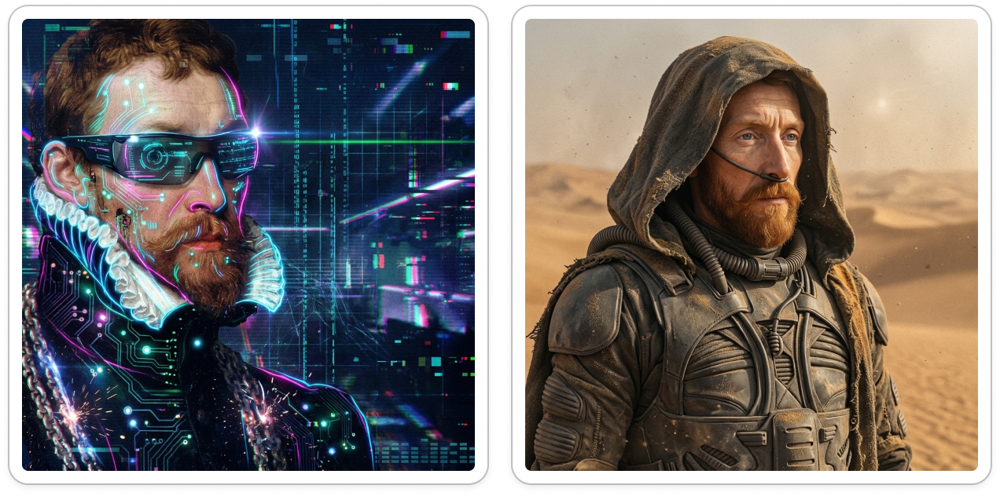
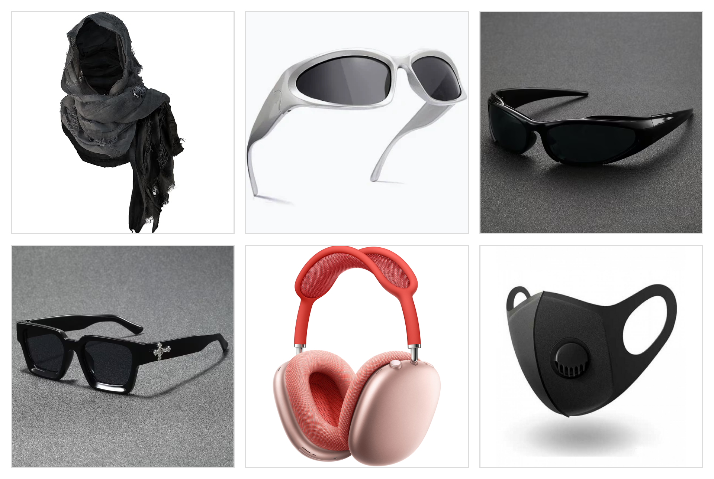
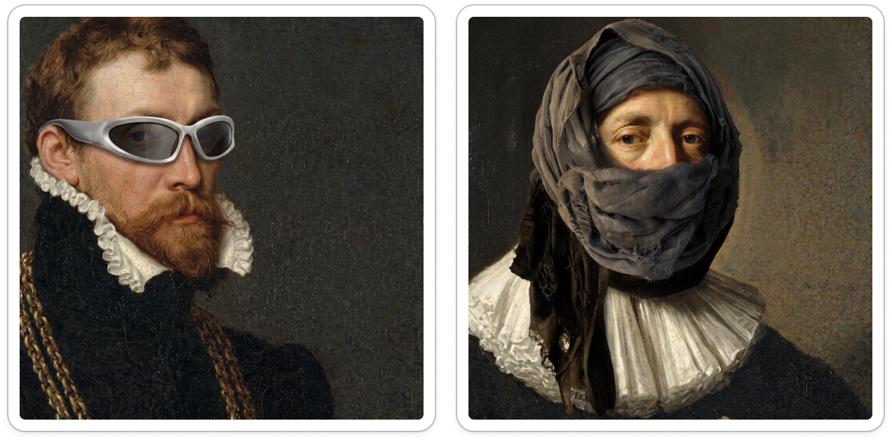
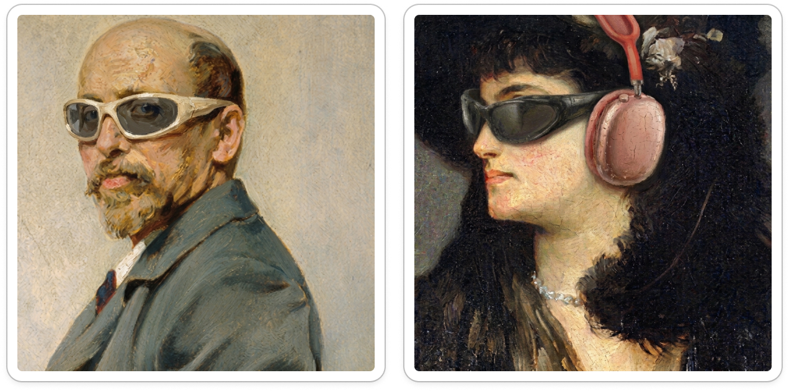
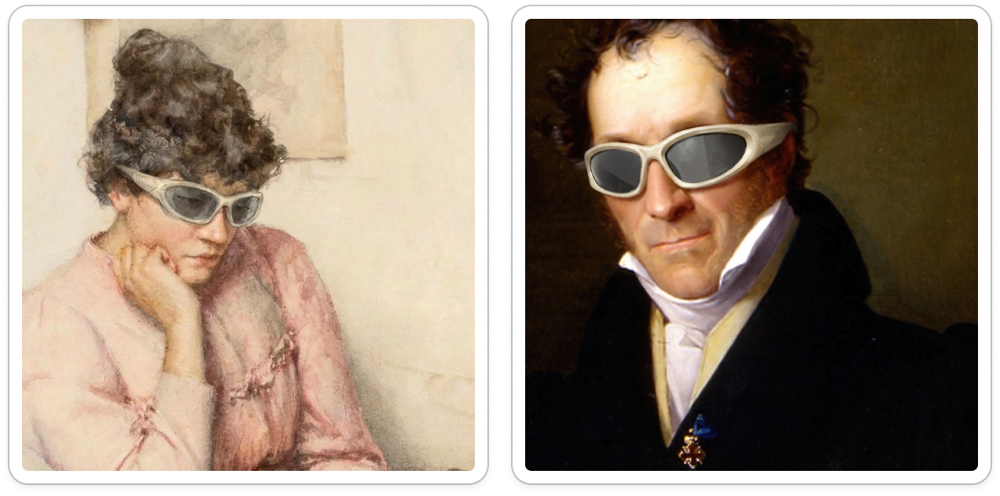
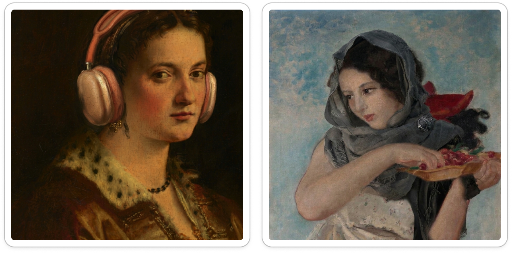
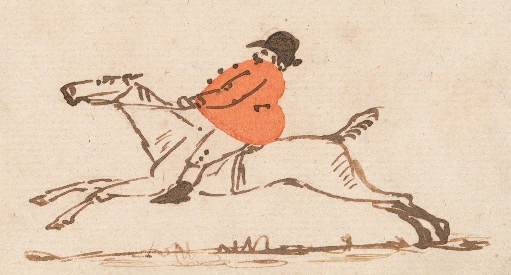

As the saying goes for LLMs:
> _[Garbage in, garbage out](https://en.wikipedia.org/wiki/Garbage_in,_garbage_out)_

LLMs are as good as the building blocks provided to them. Make use of the right building blocks for the right use cases and the output from LLMs is so much better! These building blocks could be established abstractions like in the web (DOM, HTTP), or in software systems (containers, databases, file systems).

Higher abstractions like custom APIs and tools made available to LLMs via MCP servers allow LLMs to orchestrate them and build beautiful things.

**Let LLMs orchestrate and play with good building blocks.** The work output is often not good when you ask LLMs to implement something without you picking the right abstractions. Some models might be better at doing this themselves, but you can get so much done at little cost with better output if you can just pick the right tools.
## A simple example in art
I see AI generated slop images all over the Internet, in blog posts, in conference talks and at times in work presentations. It simply shows a lack of care from the creator of the content for the reader. Anyway, I wanted to explore how picking the right building blocks can help  create better visuals/art/graphics than just asking an LLM to generate them for you.

Task: _Generate a bunch of 1:1 portrait images which are to be used in a futuristic game for players' profile pictures._
### One-shotting
The worst method, I've always hated the LLM-generated visual output. Here's what Nano Banana 2 produced:

I don't like this slop. The image on the right looks okay and probably looks like something you'd see in a game, but I want to do better.
### Good building blocks
Now let's think in a more _good building blocks_ style. I have been a fan of this amazing website called [Artvee](https://artvee.com/) - it aggregates images of open source artwork and classical paintings from various museum datasets and makes them available for download. I have used them in my presentations and they increase the visual appeal drastically.

My idea was to take existing art work in the form of paintings, photos, elements, illustrations and ask LLMs to combine these components to build better, customised, weird art. E.g. this is what I did:

_I asked Pi to build an image pipeline which takes in a classical painting which contains some person, detects faces, cuts them to respect the rule of thirds, applies some noise for a more rustic look and outputs a set of 1:1 images._

This output is already very good because it is human-made, look at these!

Now, I wanted to see if Nano Banana does a good job if I only share these images as input and mention in the prompt what I want to do with the image. But it generates the typical AI slop-like graphics.

### Drawing not allowed
A key thing to note is that LLMs are poor at doing things from scratch. Be it programming, image generations or any generative work. I have seen better output when LLMs are asked to play around with available elements (a.k.a. _building blocks_), similar to a scrapbook. The best thing is, you - _the creator_ - can drive the LLM and ask it to mould the elements as needed to generate the output you desire.

This is what I did next: **Nano Banana is not allowed to draw/invent pixels**. It should strictly work with the elements I provide. It is free to warp them as needed though. So I provided a bunch of elements like glasses, scarves and headphones and asked it to place these elements on the faces in the images.

And it does a very good job! I love these. And as a bonus, Nano Banana also upscales the image to a very high quality.

The prompt for the second image, as suggested by Pi:
>_Edit the first image (a painted portrait of a man with a wide-brimmed hat and white ruffled collar). Apply the accessory from the second image: a distressed, frayed charcoal-gray and black gauze hooded face wrap (Dune-style stillsuit scarf). Wrap it cleanly around the man's head and lower face, covering his nose, mouth and beard, leaving his eyes visible, with the loose frayed ends draping over the collar and shoulder. Fit it naturally to the face geometry with consistent lighting and shadows. Do NOT change the art style: keep the same oil-painting look, brushwork, colors, palette, grain/noise texture, composition, and framing as the original 1:1 image; the wrap must be painted in that same style._

Did a few more as an experiment:

Asking Nano Banana to blend the element in the same style as the image generated a better output.

These glasses fit the best out of all the elements. Look at how Nano Banana nicely blended them in the first painting of this woman.

I would never recognise that the second image was edited - the scarf was added later!

The experiment was fun! It took some time and effort, but I love the output. Humans have created tremendous amount of good artwork which is graciously made available publicly and I think we should start there if non-artists want to produce new art.

The same goes for software - knowing what abstractions exist is super beneficial. While bigger models can now retrieve these out of their large memory, us humans can always drive and make the process of creating artifacts better by choosing good abstractions.
### The galloping horse
LLMs are fast at producing output which is exciting, but to steer them in your preferred direction, or to generally produce good output, you need good building blocks and effort that you need to put in. It is easy to fall for a one-shotted image, written piece or code, but this is often of poor quality and benefits none.

_Horse and Rider by Joseph Crawhall_. _Is the horse riding you or are you the one in control?_

