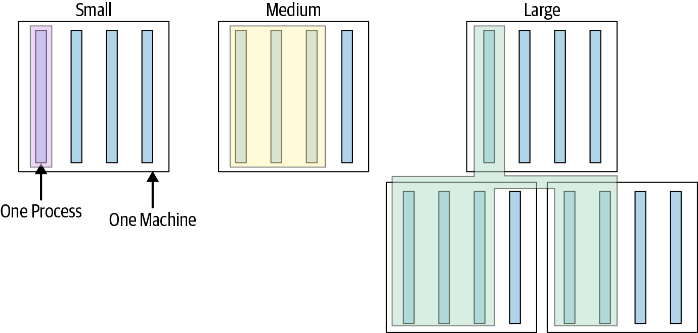

Mobile E2E tests are notoriously hard to run, especially if you run them with the app as a black box. Before testing, you need an app build, a real/virtual device and a driver that executes the tests. Nowadays, you have drivers that use LLMs to interact with the state of the screen and make it easy to run/maintain tests. But I think the problem is more fundamental - you still have to run the whole app on a device and interact with it.

```ts
// An example mobile end-to-end test with Appium 
test("View product detail screen", async ({ phone }) => {
	await phone.deviceUtils.startTheRNAppWithTokens();
	await phone.deviceUtils.followDeepLink(product.deeplink!);  // view PDP
	await addItemToCartFromPDPMobile({ phone });                // add to cart
}
```

Instead of trying to solve all the known problems with E2E tests, can we use a different type of tests which are cheaper and faster to run and still verify all the cases covered by an E2E test? I set to explore this over the weekend.
## Small, medium and large tests
A few months ago, while reading about testing at scale, I came across the great [_Software Engineering at Google_](https://abseil.io/resources/swe-book) book, especially the section [_Designing a test suite_](https://abseil.io/resources/swe-book/html/ch11.html#designing_a_test_suite). Here's a short overview of what the book suggests:

There are majorly three types of tests: small, medium and large. These are categorised not by the scope of what they verify, but by _how complex they are to run_. 

>_"A test’s size is determined not by its number of lines of code, but by how it runs, what it is allowed to do, and how many resources it consumes."_



The book suggests to write more of these small tests which run using one process and do not use network or other I/O dependencies. And it is so true in practice! In the context of TypeScript applications, tests written with Jest/Vitest are the most stable and fast-running ones as compared to setups like Playwright, which run with more than one processes.

Looking at the typical E2Es in mobile, they would be categorised as _large_ tests - they run with more than one process (the test driver, the emulator/device, the app itself, if real network is used then upstream dependencies) - it's like a cocktail of all the things that could go wrong while testing.

And the problem with large tests is that you cannot run them frequently on every change quickly as you'd have to build the app, set up the driver, execute the flow. It is hard to make all of this fast and reliable, which is why we often see E2E test suites going unmaintained and solutions like agentic testing coming through.

>Agents need a quick way to verify that things work, and their changes don't break other features, a.k.a. _a short feedback loop_.
## Large tests to small tests
There's one more kind of test that potentially covers similar ground as E2Es, often called _integration tests_. These verify that changes in different parts of the system do not break some core features of the product while _integrating_ these changes into the product.

The idea we need to double down on, in this age of LLM-written software, is to _**convert the scope of an end-to-end test to run as a small-sized test**_. How can you run tests that verify what _you intend to verify_ with E2E and integration tests without having to run all the machinery needed for them? One way to do this is make the tests _headless_. Shopify recently [shared](https://shopify.engineering/helix) how they are speeding up agentic development and verification by running headless, UI-less end-to-end tests by driving the logic directly that controls the UI. And this exactly fits the rule: _make large tests smaller_.

I took this up for Zalando's apps. We have a good number of E2E tests written to be run with Appium, a black-box testing framework. These ~100 tests take somewhere between 20-30 minutes to run across 10 parallel devices - good for release testing, but not very nice for quick feedback.

Looking at the example again:
```ts
test("View product detail screen", async ({ phone }) => {
  await phone.deviceUtils.startTheRNAppWithTokens();
  await phone.deviceUtils.followDeepLink(product.deeplink!);  // view PDP
  await addItemToCartFromPDPMobile({ phone });                // add to cart
}
```

Each step here either starts a real app, interacts with it through tools like ADB or navigates through real screens. To write a _small test_ for this scenario, we'd use a light-weight, headless testing approach that does not render the entire screen but rather only a virtual one. In this case [`@testing-library/react-native`](https://github.com/callstack/react-native-testing-library) is perfect for implementing headless E2Es, a.k.a. integration tests.

```ts
it("selects a size in the size picker and adds that size to the cart", async () => {
	const { app, traitStore } = setup();
	await app.open(PDP);
	
	await addSizeToCart(traitStore);
	
	expect(
		traitStore.productSizeSelection.selectSizeAndOffer,
	).toHaveBeenCalledWith("ABC12A00B-K110M", "MERCHANT1");
	expect(traitStore.cart.addToCart).toHaveBeenCalledWith(
		expect.objectContaining({
		sku: CART_PRODUCT.sku,
		simpleSku: "ABC12A00B-K110M",
		}),
		expect.anything(),
	);
});
```

I tasked Copilot to port 10 of the E2E tests to `@testing-library/react-native` (RNTL) by simulating the app setup flows and providing mocked dependencies. Well, it took some time to perfect the test harness it created to simulate close-to-real setup while still limiting to just RNTL.

```bash
Test Suites: 10 passed, 10 total
Tests:       39 passed, 39 total
Snapshots:   8 passed, 8 total
Time:        12.427 s, estimated 13 s
```

How does it compare to the original E2E tests?

|                                      | E2E test                                                                                    | Small-sized integration test                                                                                                            |
| ------------------------------------ | ------------------------------------------------------------------------------------------- | --------------------------------------------------------------------------------------------------------------------------------------- |
| _Number of processes to run 1 test_  | ~4                                                                                          | 1                                                                                                                                       |
| _Runtime on my Mac M4 with 14 cores_ | 40-50 seconds                                                                               | 2-5 seconds                                                                                                                             |
| _Resources needed to execute_        | A real/virtual device, app build, test driver                                               | A test framework and mocking capabilities                                                                                               |
| _Ideal for_                          | Catching backend contract regressions, native integration bugs, "full" user journeys issues | Regressions in screen-level features and interactions, rendering rules, deeplinks, module logic, event handlers, tracking events issues |
| _Strengths_                          | Testing in real-environment, real end-to-end behaviours                                     | Fast feedback, easy to run, deterministic                                                                                               |
The idea is not to compare them to choose one, but rather to choose the right one for every point in the development lifecycle:
1. _During active development_, use tests that run as fast as possible while testing fairly widely. This is achieved by adding more of small-sized tests to cover various scenarios and running them often, i.e. per commit or step in the harness/agent loop.
2. _When it is time to ship_ changes to a stage which expects stability (I intentionally avoid saying _production_ because there may be multiple stages before where this is expected), run the wider, more expensive tests.

This is almost what the [_testing trophy_](https://kentcdodds.com/blog/the-testing-trophy-and-testing-classifications) describes, as coined by Kent C. Dodds in 2018 and I'm just sad/amazed that we (or, I) keep re-discovering this every year.

I would rephrase this model in terms of the concept of _test size_:
>**_Have more of small-sized tests, make large tests small as much as possible, and keep a tiny set of important large tests._**
## Comparing coverage 
I know that the integration tests written in RNTL will not inherently provide coverage for what the larger E2E tests do. But can we measure the extent of how far RNTL tests take us? Can we figure out how much we are missing on by _not_ running the heavier E2Es?

Yes. There is a way to know how good your tests are and it is called _mutation testing_. As the name suggests, in this technique, you tests your tests by mutating parts of the system-under-test and check if these _mutants_ survive the tests. If they do, your tests miss coverage in parts of the source code which was mutated!
### Mutating with stryker

For the JS ecosystem, `stryker` is a mutation testing tool which provides a CLI and bunch of [mutators](https://stryker-mutator.io/docs/mutation-testing-elements/supported-mutators/) that change your source code in different ways. A simple example is:
```js
if(Date.now() > window.end) { drop() }
// mutated to:
if(Date.now() <= window.end) { drop() }
```

The hypothesis is that if your tests are good and cover all such scenarios, they should "kill" all the mutants produced by stryker. I selected 3 flows - a product catalog screen (`catalog`), a product detail screen (`pdp`) and an outfit detail screen (`outfit`) and ran a bunch of mutation rounds (it takes some time to run these as a set of files are modified) and the results were pretty bad overall for coverage:

| Flow      | Mutants | Killed by both | Killed by RNTL only | Killed by E2E only | Survived both |
| --------- | ------- | -------------- | ------------------- | ------------------ | ------------- |
| catalog   | 20      | 0              | 3                   | 0                  | 17            |
| pdp       | 20      | 1              | 2                   | 3                  | 14            |
| outfit    | 20      | 1              | 1                   | 2                  | 16            |
| **Total** | 60      | **2**          | **6**               | **5**              | **47**        |
I also kind of agree with these results as the tests are quite high level and may miss out on some granular changes in the code which may not reflect on the overall screen rendering. A "good" thing though is that the scores for both kinds of tests are almost the same, meaning the RNTL tests are already proving to be similar to E2Es in terms of coverage.

A problem with stryker though is that by default it makes changes without context of the code, i.e. it is purely syntactic. I wanted to design mutants that may in fact cause issues that should never pass regression checks. An easier way was to ask an agent to detect areas in code that may be related to what the tests cover and try to mutate them.
### Mutating with an agent
In this round, Copilot identified 11 mutants and ran the same process manually without stryker (i.e. test -> record -> mutate -> test -> compare). Results:

| Flow      | Mutants | RNTL killed | E2E killed |
| --------- | ------- | ----------- | ---------- |
| pdp       | 7       | 6           | 2          |
| outfit    | 2       | 2           | 1          |
| catalog   | 2       | 1           | 0          |
| **Total** | **11**  | **9**       | **3**      |
_Score: RNTL 9/11, E2E 3/11_
RNTL tests did well in this round, probably because they were testing specific things on the screen and the E2Es tried to make the tests work by using alternative journeys. Some example mutants and how the tests reacted to them:

| Flow    | Mutation                                         | RNTL         | E2E (run times)   |
| ------- | ------------------------------------------------ | ------------ | ----------------- |
| pdp     | Added-to-cart notification is never shown        | killed (11s) | survived (87s)    |
| pdp     | Cart remove mutation targets the wrong item id   | killed (11s) | survived (52s)    |
| pdp     | Remove menu action no longer removes the article | killed (12s) | killed (68s, 70s) |
| outfit  | Outfit detail top bar loses its creator title    | killed (8s)  | survived (79s)    |
| catalog | No-results component drops its message           | killed (11s) | survived (57s)    |
A surprising discovery for me was seeing the mutant `Added-to-cart notification is never shown`. In this case, the popup with a link saying "Go to cart" never appears, which should be a valid regression. But the E2E reacts to this missing popup by using the bottom tab navigation icons to go to the cart screen which passes the test. It's interesting because this is similar to human behaviour. But I strongly feel it was a fallback someone implemented for the test to "work" so that in cases where the popup is not clickable, the test uses a different way to reach the cart - thus ignoring the regression.

What these exercises highlight:
1. **RNTL integration tests cover similar product features as E2E tests**, and in case a regression was introduced they would successfully catch it. That said, they cannot detect an issue caused by an underlying dependency e.g. native or data API layers. This highlights a key fact: **_integration tests can replace E2E tests when the chance of a regression due to code change is high_**.
2. **It is extremely cheap to extend the RNTL tests** as compared to E2Es run with Appium. They detect issues faster - almost 5-10 times faster than E2Es.
## New possibilities
Being able to simulate the entire app creation and screen loading flow in a headless format like RNTL invites new domains that do not need a full device for testing. A great example where we've often struggled is tracking events. In a distributed setup, ensuring that screens emit the right tracking data across hundreds of modules they load is important. We've had many incidents in the past where this contract broke and led to crucial data being missing which eventually led to impact on ad allocation and spending.

With RNTL _integration_ tests, verifying tracking data is extremely easy. A new harness wraps runtime code and intercepts calls to APIs that emit tracking events and a test can then verify if an interaction leads to the right schema for tracking being used in the emitted data.

```ts
it("emits only schema-valid events", async () => {
	await openPdp().open(PDP);
	click(
	  within(screen.getByLabelText("Product image gallery")).getByLabelText(
		"mobile.app.add.to.wishlist",
		{ hidden: true },
	  ),
	);
	
	const events = trackedEvents.all().filter((event) => event.kind === "ga4");
	expect(events.length).toBeGreaterThan(0);
	for (const event of events) {
	  expect({
		event: event.name,
		violations: schemaViolations(event),
	  }).toEqual({
		event: event.name,
		violations: [],
	  });
	}
});
```
## Next steps from here
I wrote a testing strategy a month ago for my org at Zalando and one of key points there is _use more of small tests and make large tests small_ and I am going to double down on this. This exercise is part of a larger idea to make testing mobile experiences fast, deterministic and easy to maintain with agents. As agentic engineering and the concept of _software factories_ becomes more commonplace, testing and verifying software works is going to be the most challenging and interesting 