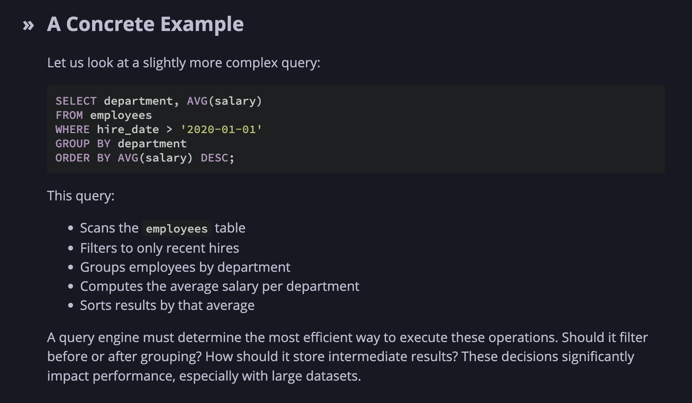

Query engines are like interpreters - they interpret SQL commands and execute them on a dataset. In a way, they are specialised interpreters.

Pipeline:
Parsing → Planning → Optimization → Execution
https://howqueryengineswork.com/01-what-is-a-query-engine.html#a-concrete-example

