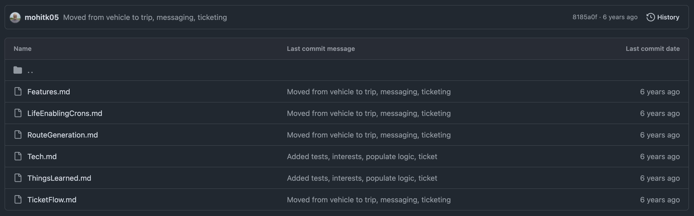
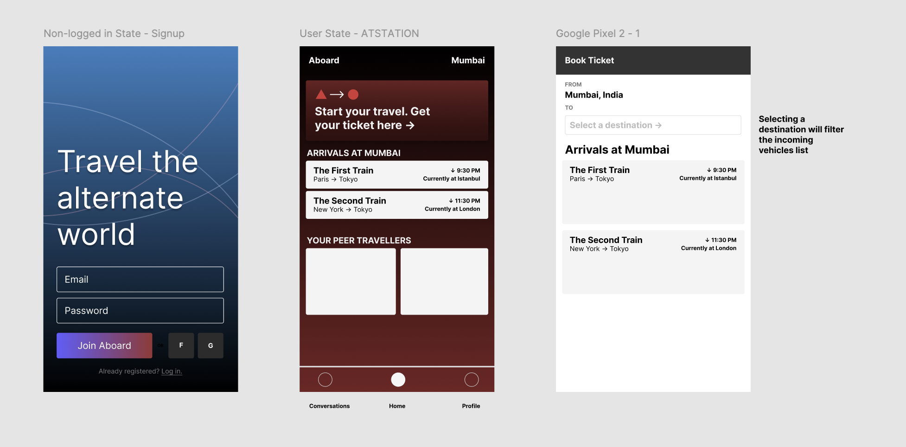
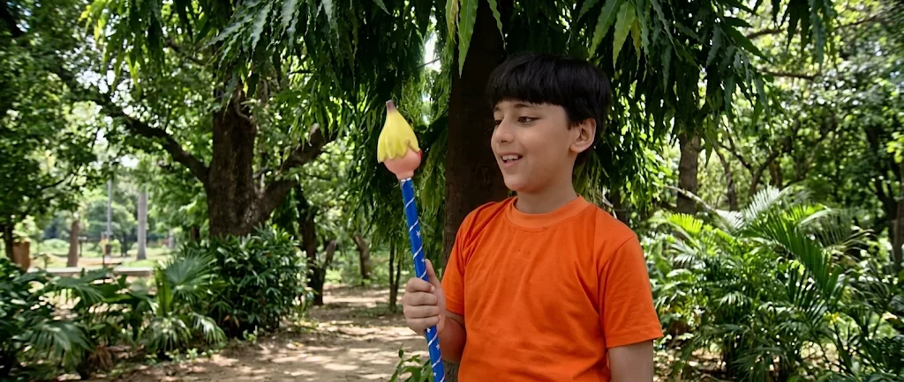

Recently on a day off I was putting the dishes in the dishwasher, while I saw Claude reply and work on a message I sent it just before. It was for a game I'm building called [Aboard](https://aboard.karekar-mohit.workers.dev/story). It suddenly struck to me how things have changed with LLMs over just a few months and how normal it has become so quickly! I have the power to create things out of thin air at my fingertips, it feels like magic.

Since early this year, I have been extensively working with agents and becoming more "AI-pilled" if that's the appropriate term, both at work and on my personal projects. I have tried so many new ideas, revived a bunch of my old (dead) projects and tried to improve my work and the setup around it with agents.

The game I mentioned, Aboard, was an idea I had during the Covid pandemic while we were locked away. I remember back then I was talking to a friend about this idea and I remember making (incomplete) [notes](/posts/2020/documenting-aboard/) about the plot, the gameplay and how elements in the game would behave. [Simple `.md` files](https://github.com/mohitk05/aboard/tree/8185a0f9f1c1eee60b94a7d02f2b946ed3291d4b/docs), it was new for me back then (vs. the immediate execution mode I'd usually do before this project). Over the next days I built a minimal game loop in Node.js without any frontend, just the entities and their movements.

I built a few simple mockups for the frontend in Figma, played around with some UI for the client to be a mobile app. I am a noob at design/UX so these were extremely simple, more of notes for myself about how the game would look like for a player. I deployed the Node.js server and connected it to MongoDB for persistence. The APIs worked, and the world in Aboard moved!

Over the next weeks, as for most of my side projects back then, the idea slowly died out as I could not get time to work on it, or simply because the feedback loop became large enough to suck out the joy in it.

Cut to a few weeks ago, some time in October 2026. While being neck-deep into the world of LLMs and agents, I decided to resume the idea for Aboard. Thanks to my markdown _specs_, one prompt in I had modernised the setup with Claude: from JS -> TS, custom deployed Node.js and MongoDB to Cloudflare Workers and Durable Objects, a strong test suite and full push to deploy workflow.

Another prompt and I was looking at a simple UI for the game! I could see the idea I had in my mind come to life! I recalled the joy I had first experienced when working with HTML in the browser, back in school. A few prompts in Claude had built a game UI, thanks to publicly available [gamedev skills](https://github.com/gamedev-skills) and I now had a tangible version of my idea. Hence came more ideas - that's how ideas work! I added a set of core features, and then a few more.

I wanted to share the game quickly with friends, so I asked Claude to build an invite link setup. It's done. I wanted to generate some [cool profile images for players](/posts/2026/llms-need-good-building-blocks/), it was a fun one, and it's done. I wanted to explore ways to expand the world and add more elements, and it's done.

Every now and then, I open a session with Claude and ask it to add a new thing to the game. My wife, who is a designer, has joined the project! She refined the gameplay and iterated on the onboarding experience along with Claude. It has become a pair project now, thanks to us sharing our Claude account. It's almost like [_digital gardening_](https://maggieappleton.com/garden-history), but with your collection of projects. You nurture them over time. They are there, somewhere on the Internet and once in a while you tend to them.

I know this is probably very simple as compared to what people have been doing out there on X or even at work, and it is probably too obvious to say it out loud, but I just want to appreciate this amazing _power_ we've received and in a moment we just accepted it as if there was no other way to do things! I love it.

We've been handed magic ✨

---

<figure style="margin: 20px 0;">
  
  <figcaption style="font-size:0.9rem;">An enhanced version of a still from a Hindi series called <em>Shaka Laka Boom Boom</em> which we used to watch as kids. The guy finds this magic pencil - anything you draw with it gets real! I was reminded of this, and ended up watching a couple of <a href="https://www.youtube.com/watch?v=QrIfagdfCts">episodes</a>.</figcaption>
</figure>
